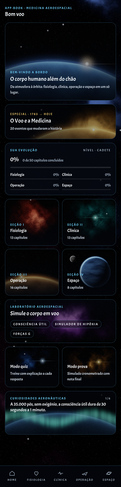

# App-Book de Medicina Aeroespacial

App em React Native (Expo) com o conteúdo de medicina aeroespacial organizado em 4 seções e 50 capítulos, para médicos e leigos.

<p>
  
</p>

## O que já funciona

- **Home** no tema sideral: apresentação, card especial O Voo e a Medicina, evolução do aprendizado, as 4 seções, Laboratório Aeroespacial, Modo quiz, Modo prova e Curiosidades aeronáuticas.
- **Rodapé:** HOME · FISIOLOGIA · CLÍNICA · OPERAÇÃO · ESPAÇO.
- **Seções** com a lista completa de capítulos e tópicos (Fisiologia 13, Clínica 13, Operação 16, Espaço 8).
- **Capítulo-modelo completo:** Fisiologia › 3. Respiração e hipóxia, com os três níveis de leitura sempre visíveis (Essencial, Entenda, Para profissionais), pontos-chave e o botão **TESTE O CONHECIMENTO** no final.
- **Testes** com correção a cada resposta, resultado, revisão das erradas e link para voltar ao tópico de origem. Com 70% de acertos, o capítulo conta como concluído na evolução, salva no aparelho.
- **O Voo e a Medicina:** 20 eventos em 5 eras, com teste no final de cada era.
- **Modo quiz e Modo prova** sorteando questões de todo o app (a prova tem cronômetro e nota no fim).
- **Laboratório:** calculadora de tempo de consciência útil por altitude (FAA, AC 61-107). Os simuladores de hipóxia, forças G e descompressão aparecem como "em breve".

Os demais capítulos mostram título e tópicos com a marcação "em produção" até receberem texto.

## Rodar o projeto

```bash
npm install
npx expo start
```

Depois, abra no Expo Go (Android ou iOS) lendo o QR code, ou pressione `w` para abrir no navegador.

Outros comandos:

```bash
npm run typecheck   # verificação de tipos
npm run export:web  # gera a versão web estática em dist/
```

## Onde fica cada coisa

| Caminho | Conteúdo |
| --- | --- |
| `src/app/` | Telas e rotas (Expo Router) |
| `src/app/(tabs)/` | Home e as 4 seções do rodapé |
| `src/app/capitulo/[secao]/[numero].tsx` | Tela de capítulo |
| `src/app/teste.tsx` | Testes de capítulo, de era, modo quiz e modo prova |
| `src/data/secoes.ts` | Estrutura completa: 4 seções, 50 capítulos e tópicos |
| `src/data/capitulos/` | Capítulos já redigidos (um arquivo por capítulo) |
| `src/data/historia.ts` | Card O Voo e a Medicina |
| `src/data/extras.ts` | Curiosidades e dados do laboratório |
| `src/constants/theme.ts` | Cores, fonte e tamanhos |
| `assets/images/cenas/` | Imagens de fundo dos cards |
| `tools/cenas/` | Scripts Python que geram as imagens de fundo e os ícones |
| `tools/fonte/` | Script que corrige o circunflexo da fonte |
| `assets/fonts/` | Fonte do app e a licença SIL OFL |
| `docs/estrutura-completa.md` | Estrutura editorial completa e regras do projeto |

## Regras de design

- Fonte única: **Acme** (Google Fonts), em uma versão corrigida. A Acme original desenha o acento circunflexo (â, ê, ô) de cabeça para baixo; o script `tools/fonte/corrigir_circunflexo.py` corrige o acento e gera `assets/fonts/AppBookDisplay-Regular.ttf`. Pela licença SIL OFL, o nome "Acme" é reservado, então a versão corrigida se chama "AppBook Display". A família só tem o peso 400.
- Tamanhos permitidos: 18, 14, 12, 10 e 9px. O 9px é usado **somente no rodapé, em maiúsculas**.
- Tema escuro sideral. O destaque padrão é o azul "holograma"; a variação vermelha "sabre" está pronta em `src/constants/theme.ts`.

## Como adicionar um capítulo

1. Crie `src/data/capitulos/<nome>.ts` seguindo o modelo de `hipoxia.ts`: cada tópico com `essencial`, `explicacao`, `clinico` e `pontosChave`, e o `teste` com uma questão por tópico, indicando o `topico` de origem.
2. Em `src/data/secoes.ts`, troque a linha `cap(...)` do capítulo pelo objeto importado.

O capítulo passa a aparecer como pronto, com tempo de leitura, e o teste entra automaticamente no Modo quiz e no Modo prova.

## Obras de referência

Ernsting's Aviation and Space Medicine (5ª ed.), Fundamentals of Aerospace Medicine (5ª ed.), Handbook of Aviation and Space Medicine, Fisiologia Aeroespacial (Russomano et al.) e A Gravidade, Esta Grande Escultora (Vernikos & Russomano), além das normas da ICAO, EASA, FAA e ANAC.
