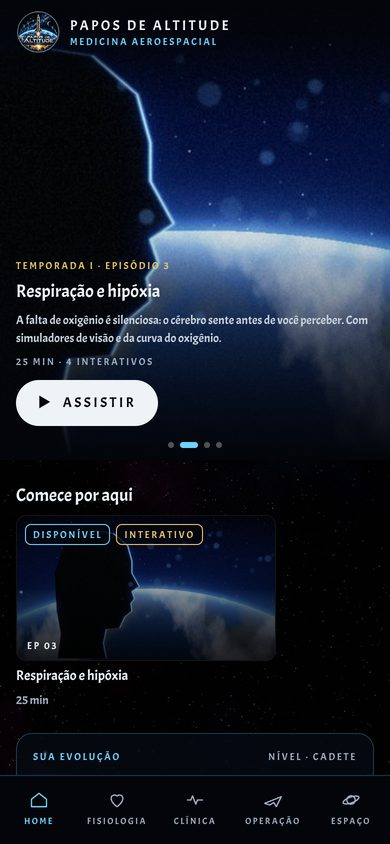
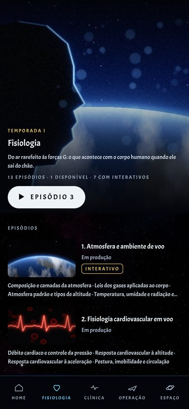
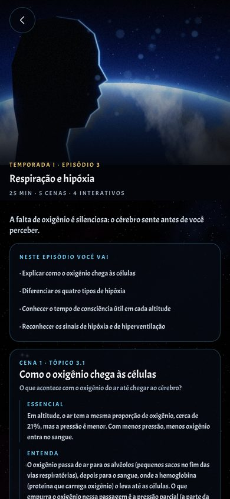
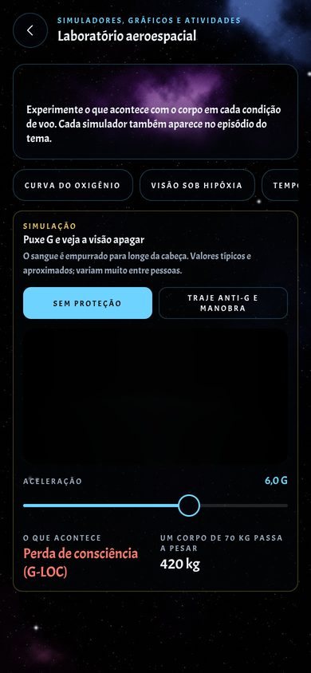

# Papos de Altitude

App-book de medicina aeroespacial em React Native (Expo), com a experiência de uma série: 4 temporadas, 50 episódios, uma série especial de história e um laboratório de simuladores. Feito para médicos e leigos.

<p>
  
  
  
  
</p>

## A experiência

- **Abertura de cinema** com o logotipo do Papos de Altitude (toque em "Pular" para ir direto).
- **Home em estilo série:** destaques rotativos no topo, "Continue de onde parou", sua evolução, uma fileira de episódios por temporada, a série especial O Voo e a Medicina, o Laboratório, os modos quiz e prova e as curiosidades.
- **Temporadas** (as 4 seções do rodapé: Fisiologia, Clínica, Operação, Espaço) com arte própria, sinopse e lista de episódios com capa, duração e selos "Disponível" e "Interativo".
- **Episódios** (os capítulos) com capa de cinema, cenas (tópicos) nos três níveis de leitura sempre visíveis, interativos dentro das cenas, o botão **TESTE O CONHECIMENTO** no final e os próximos episódios.
- **Capa própria para cada um dos 50 episódios**, arte para cada temporada e para a série especial: imagens cinematográficas fotorrealistas geradas por IA, sem texto nem marcas.

## Interativos

| Interativo | Onde aparece |
| --- | --- |
| Curva do oxigênio e cascata do O₂ por altitude | Fisiologia › Ep 3, Hipóxia |
| Tipos de hipóxia (atividade com casos) | Fisiologia › Ep 3 |
| Tempo de consciência útil (gráfico, com descompressão rápida) | Fisiologia › Ep 3 |
| Visão sob hipóxia, com os estágios clássicos | Fisiologia › Ep 3 |
| Expansão dos gases com a altitude (Lei de Boyle) | Fisiologia › Ep 1 e Ep 5 |
| Forças G, com e sem proteção | Fisiologia › Ep 6 |
| Adaptação ao escuro | Fisiologia › Ep 9 |
| Ruído e tempo máximo de exposição (NR-15) | Fisiologia › Ep 10 e Operação › Ep 6 |
| Radiação cósmica por ano de voo | Fisiologia › Ep 12 |
| Regra do 1% | Clínica › Ep 1 |
| Perda óssea no espaço | Espaço › Ep 2 |

Todos ficam também no **Laboratório aeroespacial**. Os componentes estão em `src/components/midia/`; para pôr um interativo num episódio, use o campo `laboratorio` do capítulo ou `midias` do tópico em `src/data/`.

## O que já tem texto

O episódio de Hipóxia está completo e serve de modelo. Os outros 49 episódios mostram capa, cenas e interativos, com a marcação "Em produção" até receberem texto. A série O Voo e a Medicina tem os 20 eventos e um teste por era.

## Rodar o projeto

```bash
npm install
npx expo start
```

Abra no Expo Go (Android ou iOS) lendo o QR code, ou pressione `w` para abrir no navegador.

```bash
npm run typecheck   # verificação de tipos
npm run export:web  # versão web estática em dist/
```

## Onde fica cada coisa

| Caminho | Conteúdo |
| --- | --- |
| `src/app/` | Telas e rotas (Expo Router) |
| `src/app/(tabs)/` | Home e as 4 temporadas do rodapé |
| `src/components/moldura-app.tsx` | Cabeçalho e rodapé fixos em todas as telas |
| `src/app/capitulo/[secao]/[numero].tsx` | Tela de episódio |
| `src/app/teste.tsx` | Testes de episódio, de era, modo quiz e modo prova |
| `src/app/laboratorio.tsx` | Laboratório com todos os interativos |
| `src/components/streaming.tsx` | Fileiras, capas de episódio e destaques rotativos |
| `src/components/abertura.tsx` | Abertura animada |
| `src/components/midia/` | Simuladores, gráficos e atividades |
| `src/lib/fisiologia.ts` | Cálculos de fisiologia usados nos interativos |
| `src/data/secoes.ts` | Estrutura: 4 temporadas, 50 episódios e tópicos |
| `src/data/capitulos/` | Episódios já redigidos (um arquivo por episódio) |
| `src/data/historia.ts` | Série especial O Voo e a Medicina |
| `src/constants/capas.ts` | Índice das capas de episódio e artes de temporada |
| `src/constants/theme.ts` | Cores, fonte e tamanhos |
| `assets/images/capas/` | Capas dos episódios e artes das temporadas |
| `assets/images/logo-app.webp` | Logotipo usado dentro do app |
| `tools/cenas/` | Geradores das capas, do fundo estelar e das cenas |
| `tools/fonte/` | Correção do circunflexo da fonte |
| `docs/estrutura-completa.md` | Estrutura editorial completa e regras do projeto |

## Regras de design

- Fonte única: **Acme** (Google Fonts), em uma versão corrigida. A Acme original desenha o acento circunflexo (â, ê, ô) de cabeça para baixo; `tools/fonte/corrigir_circunflexo.py` corrige o acento e gera `assets/fonts/AppBookDisplay-Regular.ttf`. Pela licença SIL OFL, o nome "Acme" é reservado, então a versão corrigida se chama "AppBook Display". A família só tem o peso 400.
- Tamanhos permitidos: 18, 14, 12, 10 e 9px. O 9px é usado **somente no rodapé e nos selos (Interativo, Disponível, tipo de mídia), sempre em maiúsculas**.
- Cabeçalho e rodapé sempre fixos na tela: logotipo à esquerda com PAPOS DE ALTITUDE e, abaixo, MEDICINA AEROESPACIAL; no rodapé, as 5 abas.
- Tema escuro sideral. O destaque padrão é o azul "holograma"; a variação vermelha "sabre" está pronta em `src/constants/theme.ts`.

## Como adicionar um episódio

1. Crie `src/data/capitulos/<nome>.ts` seguindo o modelo de `hipoxia.ts`: cada tópico com `essencial`, `explicacao`, `clinico` e `pontosChave`, os `midias` que fizerem sentido, e o `teste` com uma questão por tópico, indicando o `topico` de origem.
2. Em `src/data/secoes.ts`, troque a linha `cap(...)` do capítulo pelo objeto importado.

O episódio passa a aparecer como "Disponível", e o teste entra no Modo quiz e no Modo prova.

## Imagens

As capas, artes e cenas são imagens fotorrealistas de cinema geradas por IA, com pessoas fictícias e sem texto, logotipos ou marcas. Ficam em `assets/images/capas/` (episódios `fis-01`…`esp-08`, `temporada-*` e `especial-voo`) e `assets/images/cenas/` (fundo, abertura, laboratório, quiz, prova e curiosidades), em JPG de até 1600 px de largura. Para trocar uma imagem, substitua o arquivo mantendo o mesmo nome. Os geradores antigos de `tools/cenas/` não são mais usados.

## Obras de referência

Ernsting's Aviation and Space Medicine (5ª ed.), Fundamentals of Aerospace Medicine (5ª ed.), Handbook of Aviation and Space Medicine, Fisiologia Aeroespacial (Russomano et al.) e A Gravidade, Esta Grande Escultora (Vernikos & Russomano), além das normas da ICAO, EASA, FAA e ANAC.
